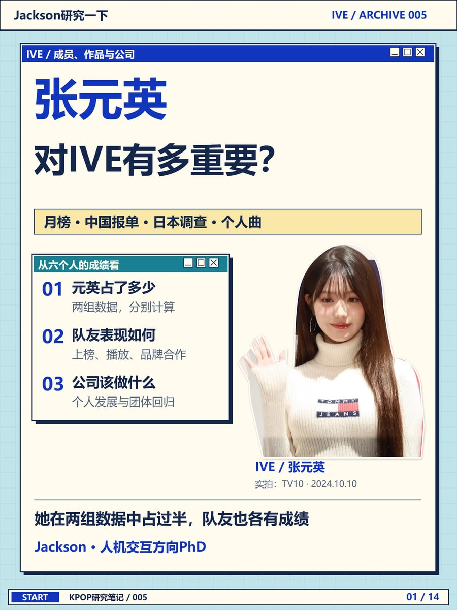

# Visual Story Styles

| [因为王俊凯，你会多看这双回力一眼吗？](examples/warrior-case.md) | [张元英对 IVE 有多重要？](examples/ive-case.md) |
| :--- | :--- |
| [](examples/portfolio/karry-cover.jpg) | [](examples/portfolio/wonyoung-cover.jpg) |
| **时尚拼贴** · 从一张代言照，追到脚上那双鞋。[翻看内页](examples/warrior-case.md) | **复古桌面** · 把成员数据、品牌合作和团体成绩排成一组档案。[翻看内页](examples/ive-case.md) |

这两篇都是「Jackson研究一下」做过的图文。Visual Story Styles 收录了制作时用到的构图、数据图和手机排版方法。给 Agent 一份简报、一组数据和有出处的图片，就可以从下面的配方开始。

[开始使用](#开始使用) · [风格与方法](#风格与方法) · [分场景指南](docs/usage.md) · [图片署名](RIGHTS.md)

## 开始使用

首次安装到 Codex 的技能目录，在终端运行：

```sh
git clone https://github.com/Jackson-jjc/visual-story-styles.git ~/.codex/skills/visual-story-styles
```

在 PowerShell 中，目标路径可写为 `"$HOME/.codex/skills/visual-story-styles"`。已有同名目录时先核对本地改动。其他支持 Agent Skills 的工具可将仓库放入其技能目录，保留 [SKILL.md](SKILL.md)、`references/` 和 `examples/` 的相对位置。

**第一次试用**，把下面这段交给能读本地文件、绘制图表的 Agent：

> 使用 $visual-story-styles，读取 Skill 目录下的 examples/brief.json。按复古桌面风格做一张收藏数对比图。请保留 72 小时、单位和虚构数据标注，导出 PNG 和可编辑 SVG，再按手机宽度检查一次。交付时告诉我替换数据的位置。

打开成图，应该能读出示例 A、B、C 分别有 12、8、5 次收藏。可以对照[可编辑的复古桌面练习图](examples/retro-study.svg)，或看[实际笔记的品牌合作页](examples/ive-case.md)。换自己的稿，只需先给读者要回答的问题、原图、数据来源和目标平台。[分场景操作指南](docs/usage.md)

## 风格与方法

本仓库安装一个 Skill。每次从下表选一条风格，再按内容调用需要的方法。

| 我手上的任务 | 读哪个模块 | 做完拿到什么 |
| --- | --- | --- |
| 人物、服饰、专辑、商品细节 | [剪贴拼贴](references/collage.md) | 主图裁切、细节图和文字留白 |
| 资料整理、前后版本、同口径数据 | [复古桌面](references/retro-desktop.md) | 有统一参照的档案页或比较图 |
| 喜欢一个参考版面，想用于整组图 | [从参考到视觉系统](references/visual-system-workflow.md) | 能复用的字级、配色及构图 |
| 现有版式显乱、每页像同一个模板 | [Impeccable 编辑排版方法](references/impeccable-collage-trial.md) | 一张可以与原稿并排看的修订样张 |
| 需要比较数量、占比、时间变化 | [数据可视化](references/data-viz-harness.md) | 图形、数值、单位、时间窗和来源 |
| 图要发到手机上 | [阅读与证据检查](references/reading-and-evidence.md) | 缩略图检查和具体修正 |

## 实作：一篇代言报道怎样从数据讲到一双鞋？

[王俊凯 × 回力](examples/warrior-case.md)从两处具体改稿讲起：评论和股价之后怎样接到选鞋，人物和鞋底怎样裁切才看得全。案例附自制数据图、原始报告和可替换的练习图。

[示例简报](examples/brief.json) · [视觉参数](examples/system-contract.json) · [数据口径模板](examples/data-viz-contract.json) · [参考出处](SOURCES.md) · [使用与素材权利](RIGHTS.md)
