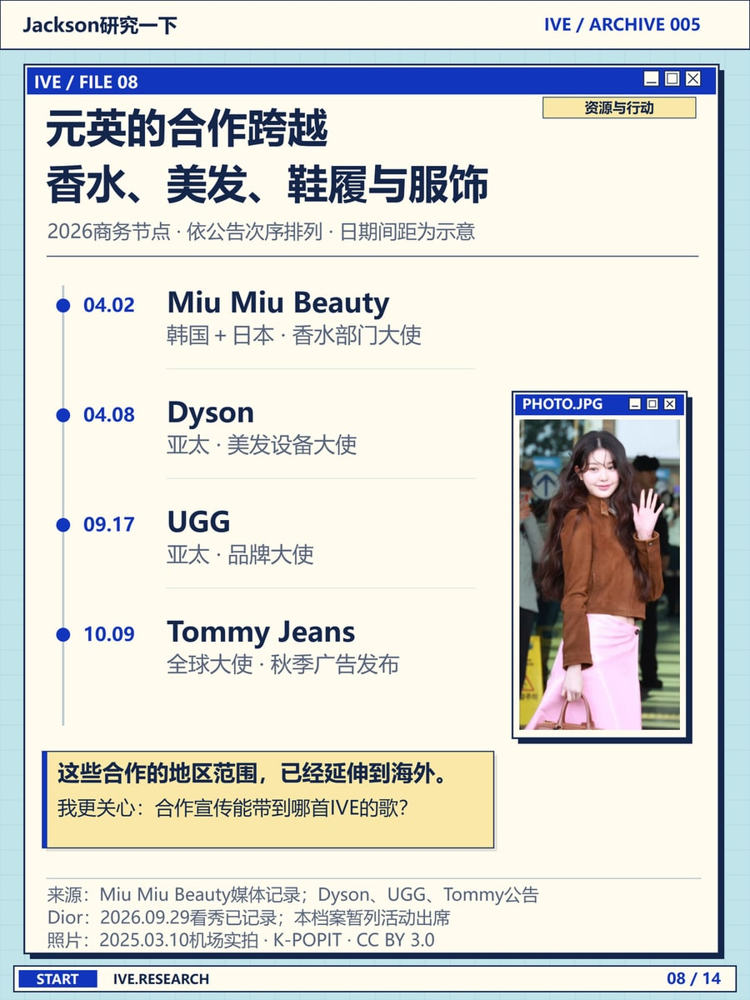

# 张元英对 IVE 有多重要？

这是「Jackson研究一下」复古桌面系列的第 8 页。[封面](portfolio/wonyoung-cover.jpg)把读者要追的问题放进三个目录项：元英占了多少、队友表现如何、结果怎样进入团体成绩。翻到品牌合作这一页，标题栏仍在同一位置，正文换成一列时间线。

这页里，4 月 2 日的 Miu Miu 和 10 月 9 日的 Tommy Jeans 各占一行，日期、品牌和合作内容可以横着读。右侧小窗放的是 2025 年的机场照，图下注明拍摄日期；左侧时间线记录的是 2026 年的品牌节点。

做自己的档案页时，可以保留这组对应关系：文件标题写问题，左边放能回答问题的记录，照片和拍摄日期放在一起。如果只有一件事要讲，一张大图和一句图注就足够了。[复古桌面配方](../references/retro-desktop.md) · [图片来源与摄影署名](../RIGHTS.md)
