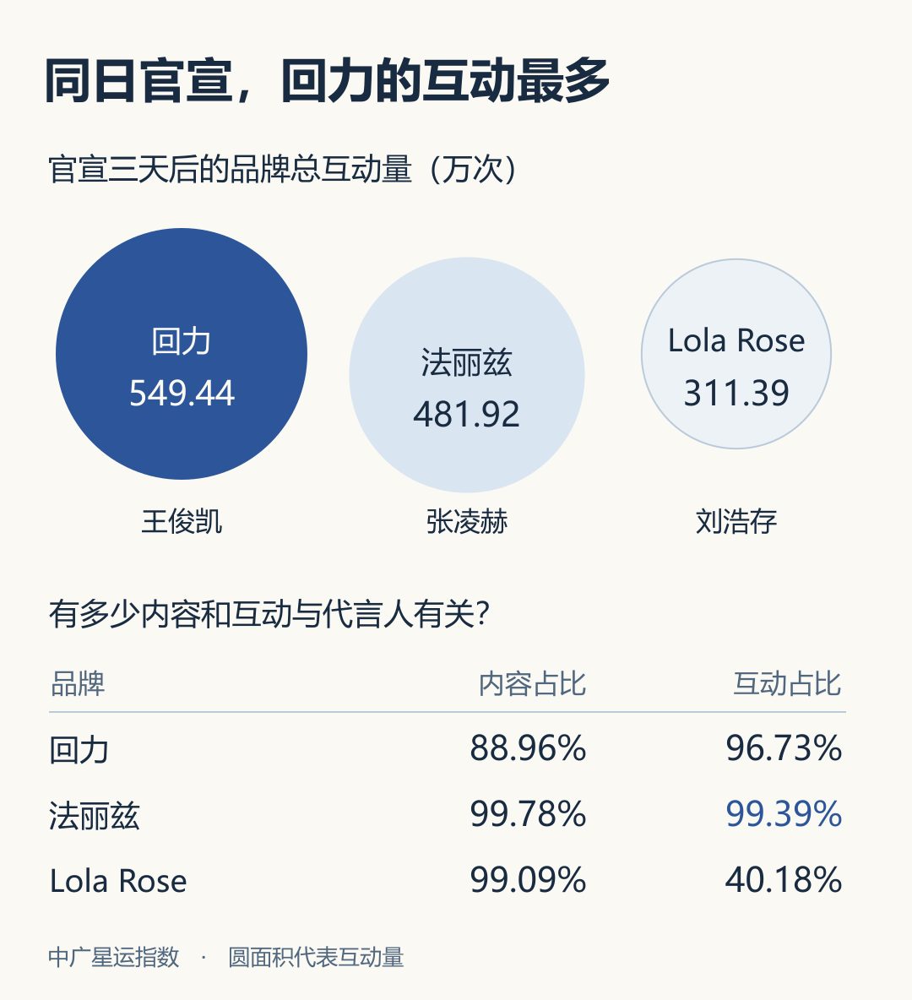

# 王俊凯 × 回力｜从品牌互动到一双鞋

封面问“因为王俊凯，你会多看这双回力一眼吗？”前半篇要说明读者在关注什么，后半篇要回答这双鞋适合怎样穿。以下是本次图文的实际编辑取舍。

**比较对象怎样选。** 三组都在 10 月 15 日官宣，用同一机构、官宣三天后的观察口径。回力 549.44 万次、法丽兹 481.92 万次、Lola Rose 311.39 万次。图中圆的面积对应总量，下表单列两种比例。回力相关内容有 88.96% 同时提到王俊凯，这部分内容获得了品牌同期 96.73% 的互动。两个百分数各有自己的分母。数据见[回力报告](https://m.weibo.cn/2/detail/5359307455726645)、[法丽兹报告](https://m.weibo.cn/2/detail/5359307226875000)、[Lola Rose 报告](https://m.weibo.cn/2/detail/5359307336976116)。

**第 5 页为什么能接到第 6 页。** 母公司的收盘价和官博评论分别回答股价表现和品牌讨论热度。真正带读者走到商品页的，是官宣当天下午已有读者在话题里问大家买了哪款。把这件事留在翻页前，下一页再写作者点开了哪双鞋。

**一次不成功的版式调整。** 把三种参考分别套在第 4、6、7 页后，创作者更喜欢原版，最终沿用了原版九图。能留下的是几种具体手法：街头大屏页用现场图交代投放位置；产品页用原色图加鞋边细节；两款鞋并排时比较同一尺码、同一天的标价。跨页的字体、颜色和读序一起检查。

**导出时发现的裁切。** 公众号正文图右侧标题最后一个字贴到蓝框边缘，左边照片的近侧鞋尖也被截掉。扩大标题可用宽度，原照取景下移至整双鞋可见，再检查缩略图。仓库提供一张[原创黑米配色练习图](collage-study.svg)，可以自由替换画布和标题长度练习这一步。原报道使用的品牌照片另见[回力官方搭配帖](https://www.sina.cn/news/detail/5360763570751170.html)。
